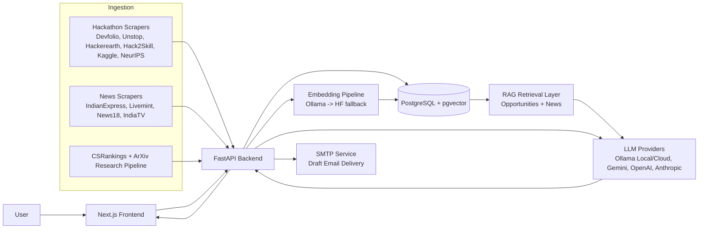

## Demo

- Deployed URL: http://3.109.5.77/

## 1. Oppora: The Opportunity Oracle Platform for Students

**Discover active hackathons, track applications, send personalized emails to professors, and stay updated with your field—all in one place.**

---

## 2. The Problem

Have you ever missed a great hackathon or competition just because you didn't know it was happening? It is frustrating to check so many different websites just to see what is open right now.  

Finding research work is just as hard. Reaching out to professors means spending hours reading their papers and writing custom emails from scratch for every single one.  

Plus, trying to keep up with the latest news in your major means bouncing between too many different sites.  

**Oppora fixes all of this for you.** It is one single place that: 
- **Lists active competitions:** See all the open hackathons and events in one spot.
- **Helps you email professors:** It helps write smart, personalized emails for you based on the professor's actual research.
- **Gives you news you care about:** You get a single feed of updates picked just for your interests.

Oppora takes care of the searching, so you can get right to the actual work.

---

## 3. What It Does

Oppora gives you a set of powerful tools to handle everything from finding an event to applying for it:

* **Find Opportunities Fast:** Shows all open hackathons in one clean list, making it easy to see deadlines before they pass.
* **Smart Filters:** Sort the list by the skills you have, the topics you like, or whether the event is online or in person.
* **Save and Track:** Bookmark events you like, and use the built-in tracker to see the status of your applications (like *Interested*, *Applied*, or *Accepted*).
* **SeerAI (Opportunity Helper):** A smart chatbot built right in. You can ask it questions about any hackathon or opportunity, and it will give you instant answers.
* **ScrollAI (News Helper):** Instead of checking ten websites, this tool reads the news for you and finds the exact updates you care about.
* **ScribeAI (Email Helper):** A full studio to help you get research roles. It reads your resume, helps you find professors from different countries, looks up their recent papers, and writes a custom email for you to review and send.
* **Auto-Updating Dashboard:** In the background, Oppora constantly pulls in fresh events and news while cleaning out old ones, so you always see the latest data.

---


## 4. Tech Stack

- Frontend: Next.js App Router, TypeScript, Tailwind CSS, TanStack Query, Zustand, Radix UI.
- Backend: FastAPI, SQLAlchemy, Alembic, Pydantic Settings.
- Database: PostgreSQL + pgvector.
- Scraping & Ingestion: Playwright, BeautifulSoup, httpx.
- AI/LLM: Ollama (local + cloud), Gemini, OpenAI, Anthropic.
- Embeddings/RAG: Ollama embeddings with local Hugging Face fallback (Nomic Embed model).
- ML utilities: BERT topic classifier support for news topic backfill.

---


## 5. Architecture Diagram



---


## 6. Getting Started / Setup

### Prerequisites

- Python 3.10+
- Node.js 20+ and npm
- Docker Desktop (for local PostgreSQL)
- Optional but recommended: Ollama running locally for fast local embeddings/chat

### Quick Setup (5 Steps)

1. Clone and enter project:

```bash
git clone https://github.com/devg05/Oppora
cd Oppora
```

2. Create env file:

```bash
copy .env.example .env
```

3. Start PostgreSQL:

```bash
docker compose up -d
```

4. Create venv and Install dependencies:

```bash
python3 -m venv .venv
```

For Linux users: 
- source .venv/bin/activate

For Windows users: 
- .venv\Scripts\activate

```bash
pip install -r requirements.txt
playwright install chromium
playwright install-deps chromium

npm install --prefix frontend
```

5. Run migrations and start apps:

```bash
python -m cli db upgrade
```

If you change `.env` values like `ADMIN_SIGNUP_KEY`, `DATABASE_URL`, or `SUPABASE_DB_URL`, restart the backend process before testing again. The API reads settings at startup.

Terminal A:

```bash
python -m cli app
```

Terminal B:

```bash
cd frontend
npm run build
npm run dev
```

App URLs:

- Frontend: http://localhost:3000
- API Docs: http://localhost:8000/docs

### Environment Variables (What to Fill + How to Get)

Use the simplified `.env.example` included in this repo.

Minimum for local run:

- `DATABASE_URL`: keep default for local Docker Postgres.
- `JWT_SECRET_KEY`: set any strong random string.

For Supabase-backed deployment or testing:

- `SUPABASE_DB_URL`: set this to your Supabase Postgres connection string.
- `DATABASE_SSLMODE`: set this to `require` unless your Supabase URL already includes `sslmode=require`.
- `DATABASE_URL`: leave the local default in place as a fallback, but the backend will prefer `SUPABASE_DB_URL` when it is set.
- After updating any of these values, restart the backend so the new settings are loaded.

Optional keys by feature:

- `COLDEMAIL_PROFILE_API_KEY`:
   - Needed for ScrollAI and ScribeAI resume-profile extraction/free-tier cloud flows.
   - Get from your Ollama Cloud account.
- `API_KEY_ENCRYPTION_KEY`:
   - Needed only if you plan to save Gemini/OpenAI/Anthropic/Ollama Cloud API keys in Settings.
   - Generate with:

```bash
python -c "from cryptography.fernet import Fernet; print(Fernet.generate_key().decode())"
```

- `SMTP_*` variables:
   - Needed only to send approved cold-email drafts from the app.
- `ADMIN_SIGNUP_KEY`:
   - Needed only if you want signup-based admin creation.
   - Set it in the backend env before starting or restarting the API.
   - In the signup form, check `Create as admin` and enter the exact same key.

Optional cloud provider keys (configured inside app Settings, not in `.env`):

- Gemini API key: https://aistudio.google.com
- OpenAI API key: https://platform.openai.com
- Anthropic API key: https://console.anthropic.com
- Ollama Cloud key: https://ollama.com

Optional frontend env (only if backend is not on default localhost):

- Create `frontend/.env.local` and set `NEXT_PUBLIC_API_BASE_URL=http://<your-backend-host>:8000`

If feed data is empty after first run, create/admin-login and run ingestion jobs from the Admin page.
